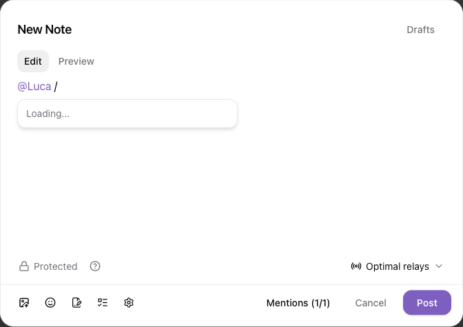
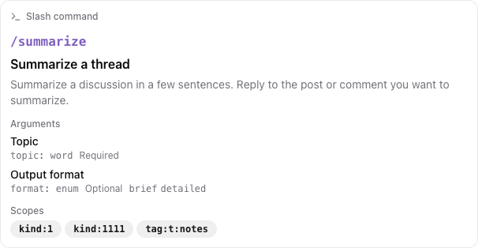

# Slash commands in the post editor

- Select a bot with `@` at the start of the editor, then type `/` to see its commands. The menu shows a loading indicator while Jumble queries relays. When a cached list exists, its commands are still selectable during refresh.
- Type `/` at the start to browse commands already cached on this device, without querying relays. Each suggestion names its executor, even when two bots advertise the same command.
- Suggestions match the outgoing note or reply kind (1 or 1111). Selecting one inserts `/command@nostr:npub…` at the beginning of the draft without sending the post. The editor highlights the command separately from its arguments.

## Command definitions

Opening a kind 31992 event shows a read-only command card with its trigger, description, arguments, and scopes. Opening or quoting a definition does not run the command.

