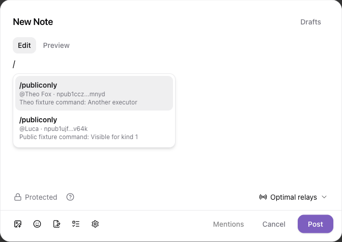

# Slash commands in the post editor

- Select a bot with `@` at the start of the editor, then type `/` to see its commands. Jumble queries the bot's advertised write relays for command definitions and caches the results for one day. After one day, its cached commands remain selectable while the menu refreshes in the background.
- Type `/` at the start to browse commands, with your saved commands first. Opening this menu uses locally available definitions. Each suggestion shows the command name, the bot's avatar and name, and a one-line description.
- Suggestions filter by the outgoing note or reply kind (1 or 1111) and the author when known. Commands with tag or relay requirements may appear before those details are known. Selecting one shows `/command` and the bot's name at the beginning of the draft. Copying the command or publishing the post uses the full `/command@nostr:npub…` text. In published notes, the command label opens its definition. Arguments remain ordinary text after the label.

## Command definitions

Opening a kind 31992 event shows the command name, what it does, and its arguments in the note body. Opening or quoting a definition does not run the command.

Use **Save** on a command's detail page to save it to your NIP-CD list (kind 10992). Manage them under Settings → Saved commands. A profile's Slash commands page lists the commands published by that account.
